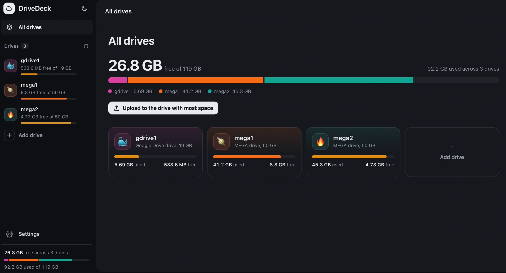
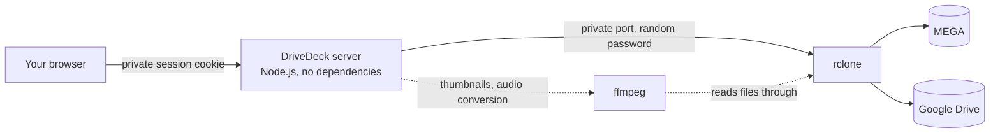

<h1 align="center">DriveDeck</h1>

<p align="center"><b>All your cloud drives on one deck.</b><br>
Browse, upload and play across your MEGA, Google Drive, Dropbox and OneDrive accounts from one local dashboard, powered by <a href="https://rclone.org">rclone</a>.</p>

<p align="center">
  
  
  
  
</p>

```bash
npx drivedeck
```



## Why

Free cloud storage is spread thin: 20 GB here, 15 GB there, across several providers and accounts. DriveDeck puts them side by side. You see how much space you have in total and on each drive, open any of them in a fast file browser, upload to whichever has room, and play your music or look through photos without signing in to five websites.

It runs on your own computer. Your files go straight between your browser, rclone and your cloud provider, and nothing passes through anyone else's server.

## Highlights

- **Search every drive at once.** Press Cmd/Ctrl+K and type part of a name: results from all your drives appear as you type, with the drive and folder each file is in.
- **Move and copy between drives.** Pick any drive and folder, or drag files onto a drive in the sidebar. DriveDeck checks there's room and asks before overwriting anything.
- **Find duplicates.** See files stored more than once across your drives, biggest first, and delete the extra copies to free space.
- **One view of all your storage.** Free and used space across every drive in a single bar, with a color and emoji for each drive. Sizes show instantly on launch and refresh in the background. Drives that are 90% full get a warning, and an upload too big for its drive offers the drive with the most room instead.
- **A file browser that feels like an app.** Grid and list views, sorting and filtering. Select several files with Shift or Cmd/Ctrl-click, rename with F2, and download a folder or a selection as one zip. Folders you've already opened load instantly, and the scroll position is remembered.
- **Share links.** Create a link anyone can open, copy it in one click, and stop sharing later.
- **Previews for PDFs, text and code.** PDFs open in the browser's PDF reader; text, Markdown, code, JSON and CSV open with line numbers.
- **Thumbnails for photos and videos.** Taken from the provider when it has them (Google Drive), otherwise made on your computer with ffmpeg, which reads only part of each file. Cached, with a size limit you choose.
- **A music player.** Plays a whole folder while you keep browsing. Common formats stream directly, and WMA, ALAC, APE, AIFF and others are converted on the fly. Shows tags and cover art, and works with your keyboard's media keys.
- **Uploads that keep going.** Drag and drop files or whole folders. Once a file reaches DriveDeck, it uploads in the background even after you close the tab, with a progress panel that survives reloads.
- **Encrypted folders.** Lock a folder inside any drive with a password. Files and their names are encrypted on your computer before they're uploaded, so the provider only stores scrambled data.
- **Backups from your computer.** Copy folders like Documents to a drive when you ask, or every hour, 6 hours or day, with an optional mirror mode.
- **Move to a new computer in one step.** Export your drives, their sign-ins, settings and backups to one password-locked file, and import it on the new computer.
- **In English and Bangla.** Switch the language in Settings.
- **Google Drive done properly.** Sign in on Google's own page, with a step-by-step guide for setting up your own Google app so you're not relying on a shared one.
- **Easy on a fresh computer.** A setup screen finds rclone and ffmpeg, and installs them with Homebrew or winget after asking, or shows the exact commands for your system.
- **Light and dark themes.** Small animations throughout, and the layout works on a phone too.

## Quick start

```bash
npx drivedeck
```

DriveDeck opens in your browser. Choose **Add drive**, pick MEGA or Google Drive, and sign in. That's it.

You need [Node.js](https://nodejs.org) 18 or later. rclone is required and ffmpeg is optional, but you don't need to install either first: if something is missing, DriveDeck opens a setup screen that helps you install it.

| Option | What it does |
|---|---|
| `--port <n>` | Port for the dashboard (default 5573) |
| `--rclone <path>` | Use this rclone binary |
| `--ffmpeg <path>` | Use this ffmpeg binary |
| `--no-open` | Don't open the browser automatically |

Closed the browser? Press Enter in the terminal where DriveDeck is running and it opens again. Press Ctrl+C to stop it.

## Supported drives

| Provider | Status | Signs in with |
|---|---|---|
| MEGA | Supported | Email and password, plus a two-factor code if you use one |
| Google Drive | Supported | Google's sign-in page, using your own Google app or rclone's shared one |
| Dropbox | Supported | Dropbox's sign-in page |
| OneDrive | Supported | Microsoft's sign-in page, then a choice of which OneDrive or library to use |
| Encrypted folder | Supported | A password, for a folder inside any of the drives above |
| Amazon S3, pCloud | Planned | |

Drives live in your normal rclone config, so `mega`, `drive`, `dropbox`, `onedrive` and `crypt` remotes you've already set up with rclone appear automatically.

## How it works



- **A thin server over rclone.** DriveDeck starts rclone's remote-control server on a random private port with a random password, and forwards the browser's requests to it. All the cloud work (listing, uploading, quotas, sign-ins) is done by rclone, which supports more than 70 providers. That makes adding the next provider mostly a UI job.
- **Zero dependencies, no build step.** The server uses only Node's standard library, and the web app is plain HTML, CSS and JavaScript. `npx drivedeck` downloads about 75 kB and starts in a moment.
- **Private by default.** It listens on 127.0.0.1 only and checks the Host header. The browser gets in through a one-time link with a random key, after which a cookie keeps it signed in until DriveDeck restarts.
- **Streaming everywhere.** Thumbnails and audio conversion read files through rclone's file server using range requests, so a video thumbnail or a song that starts halfway through doesn't download the whole file.

### Project layout

```
bin/drivedeck.js       the server: starts rclone, forwards its API, serves the app
lib/deps.js            finds rclone and ffmpeg, and installs them with Homebrew or winget
lib/oauth.js           Google, Dropbox and OneDrive sign-in through `rclone authorize`
lib/transfers.js       the background queue for uploads, copies and moves
lib/search.js          the search index and duplicate finder
lib/backups.js         backups of folders on this computer, run on a schedule
lib/setup-file.js      password-locked setup files, for moving to another computer
lib/native-thumbs.js   thumbnails from Google Drive, OneDrive and Dropbox
lib/zip.js             streaming zip writer for folder downloads, with ZIP64
public/                the web app: index.html, app.css, app.js, and i18n-bn.js (the Bangla text)
```

To work on it, clone the repo and run `node bin/drivedeck.js`. Restart it to pick up changes, since the page files are loaded once at startup.

## In more detail

### Setting up a fresh computer

On each start DriveDeck looks for rclone and ffmpeg. If rclone is missing, the browser opens a setup screen instead of the dashboard:

- **macOS with Homebrew:** choose *Install with Homebrew*. DriveDeck shows the exact command (`brew install rclone`), runs it only after you confirm, and shows the output as it goes.
- **Windows 10 and 11:** the same, using winget, which comes with Windows (`winget install --id Rclone.Rclone`).
- **Linux, or without Homebrew:** the screen shows the commands for your system, with copy buttons. Choose *Check again* when you're done.

rclone starts as soon as it's found, without restarting DriveDeck. You can add ffmpeg later from Settings, under Set up tools.

### Google Drive

Google Drive signs in on Google's own page: DriveDeck opens it in a new tab, and rclone receives the sign-in on your computer (`rclone authorize`, on port 53682). Your password never passes through DriveDeck.

Google needs an app to sign in with. When adding a drive you choose between:

- **Your own Google app (recommended).** You create it once in Google Cloud Console, which takes about 10 minutes. DriveDeck shows each step with a link to the right page, then asks for the client ID and secret (or the JSON file Google gives you). It's free, and its usage limits are yours alone. Google shows a "hasn't verified this app" warning when you sign in, which is expected for an app only you use. You can change or remove the app in Settings.
- **rclone's shared app.** No setup, but rclone is retiring it during 2026, and it can be slow when many rclone users are busy.

Each drive keeps the app it was added with. To move a drive to your own app, remove it and add it again; your files stay on Google Drive.

Deleted files go to your Google Drive bin. Google Docs, Sheets and Slides show as "Google file" and download as Word, Excel and PowerPoint files. Shared drives and "Shared with me" aren't shown yet.

### Encrypted folders

- Choose Add drive, then Encrypted folder. Pick a drive and a folder in it, and set a password. The encrypted folder then appears as a drive of its own, listed under the drive it's stored in.
- Everything you put in it is encrypted on your computer before it's uploaded, file names included, using rclone's crypt format. The drive it's stored in only sees scrambled names and data.
- To open an encrypted folder you made before, with DriveDeck or with rclone, choose the same folder and enter the same password. DriveDeck checks the password before adding it.
- There's no way to recover a forgotten password. DriveDeck doesn't add rclone's optional second password, so the password alone is enough to open the files with rclone on any computer.
- The password is saved in your rclone config, scrambled like your other sign-ins. Encrypt the config (see Privacy below) to protect it properly.
- Encrypted folders aren't added to the search index, and their thumbnails are never saved to disk.

### Backups

- In Settings, under Backups, choose a folder on this computer (DriveDeck shows its own folder browser, because browsers can't share real folder paths), a drive and a folder to back up to, and how often: when you ask, hourly, every 6 hours or daily.
- Backups add new files and update changed ones. Nothing in the backup is deleted unless you turn on Mirror, which also deletes from the backup what you've deleted here. If the folder here is empty, as it would be with a disconnected disk, a mirror doesn't run.
- Each backup shows its progress while it runs, and when it last ran and what happened.
- System files like `.DS_Store` and `Thumbs.db` are skipped.
- Backups only run while DriveDeck is running. One that was due while it was closed runs within a minute of starting it.

### Moving to another computer

- In Settings, under *Move to another computer*, choose *Export setup*. Pick the drives to include, and whether to add your settings, your Google app and your backups, then set a password. DriveDeck saves one `.drivedeck` file.
- On the other computer, run `npx drivedeck` and choose *Import a setup file* (on the first screen, or in Settings). Pick the file, enter the password, and choose what to import.
- **What it contains:** the drives from your rclone config with their sign-ins (tokens, MEGA passwords, encrypted folder passwords), their colors and icons, and optionally your settings, your Google app and your backups. Thumbnails and the search index are left out: they're rebuilt on their own.
- **How it's protected:** everything is encrypted with AES-256-GCM, using a key made from your password with scrypt. The file is useless without the password, and a wrong password or a changed file is detected. Anyone with both the file and the password can open your accounts, so don't send the two together. A forgotten password can't be recovered; export a new file.
- **Importing never signs in anywhere.** Sign-ins are copied as they are. Afterwards the home screen checks each imported drive and offers *Reconnect* for any whose sign-in didn't carry over (for example, if the provider signed the old computer out). Reconnecting doesn't touch your files.
- **Drives already here stay as they are.** An identical drive is skipped. For a different drive with the same name, you choose to add the imported one under a new name (encrypted folders stored in it follow it) or to replace the one here.
- **Backups:** a folder in your home folder is found in the new home folder (`/Users/old/Documents` becomes `/Users/new/Documents`). A backup whose folder isn't on the new computer is added paused until you choose its folder.
- Drives with rclone settings that run a program on your computer (such as SFTP's `ssh` setting) aren't imported, since a setup file may come from someone else. Add those with `rclone config`.

### Language

DriveDeck is in English and Bangla (বাংলা): choose in Settings, under Appearance. Numbers and dates follow the language too. The Bangla translation is new and needs a native speaker's review.

### Uploads

Uploads happen in two steps, and the upload panel shows which one each file is in:

1. **Sending to DriveDeck.** The browser copies the file to DriveDeck on your computer. This is usually quick, but the tab must stay open until it finishes. The browser warns you if you try to close it.
2. **Uploading to your drive.** DriveDeck uploads the file in the background with rclone, two files at a time. You can close the tab, and reopening DriveDeck shows the progress.

Folders upload with everything inside them, empty folders included: drop a folder, or choose Upload, then Upload a folder.

Uploads stop if you quit DriveDeck (Ctrl+C or closing its terminal), and may fail if your computer sleeps. The terminal lists anything that was stopped so you can upload it again. Failed uploads can be retried from the panel.

### Selecting, renaming and downloading

- Tick a file's box, or Cmd/Ctrl-click it, to start a selection. Shift-click selects everything in between, Cmd/Ctrl+A selects the whole folder and Esc clears it. While anything is selected, a plain click adds or removes items.
- The bar at the top downloads, renames (one item, or press F2) or deletes what's selected. Each file's ⋯ menu, also on right-click, has the same actions.
- A single file downloads as it is. A folder, or several items, download as one zip that DriveDeck builds as it streams, so nothing is stored on your computer first and large downloads start straight away. Files over 4 GB work too.
- Renaming a folder on MEGA or Google Drive happens on the provider's side, so nothing is copied.

### Sharing

- Choose Share link… in a file or folder's ⋯ menu, or Share in the selection bar. DriveDeck asks MEGA or Google Drive for a public link and copies it. Anyone with the link can open the file, or the folder and everything in it, without signing in.
- Stop sharing turns the link off. If the provider won't let rclone do that, DriveDeck says so, and you can turn it off on the provider's website.

### Previews

- Click an image, video, PDF or text file to open it. The arrow keys, the buttons on either side or a swipe on a phone move through every previewable file in the folder.
- PDFs open in your browser's own PDF reader, with a button to open them in a new tab.
- Text, Markdown, code, logs, JSON and CSV show as plain text with line numbers, up to the first 2 MB. Prose files wrap long lines and code doesn't; the wrap button switches. JSON saved on one line is spaced out for reading. HTML files show their code and are never run.
- Files from your drives are served to the browser in a sandbox, so an HTML or SVG file can't run scripts inside DriveDeck.

### Low space

- A drive that's 90% full or more turns amber in the sidebar and on its card, and the home screen names it, with what to do about it.
- Before an upload that's bigger than a drive's free space (counting uploads already on their way), DriveDeck offers to send it to the drive with the most room instead, to upload anyway, or to cancel.

### Moving and copying

- Select items and choose Move or Copy, use Move to… in a file's ⋯ menu, or drag files onto a drive in the sidebar or onto a folder. A picker shows every drive and folder, can create a new folder, and switches between moving and copying.
- Within one drive, MEGA or Google Drive does the work on its side, so nothing is downloaded. Between drives, files are downloaded to your computer and uploaded to the other drive, and the picker says so.
- Before starting, DriveDeck checks the destination has room, and asks what to do with items whose names are already taken: skip them, keep both (the copy becomes "Photo (2).jpg"), or replace them.
- Moves and copies run in the background like uploads, two at a time, and show in the same panel.

### Search and duplicates

- Search covers every drive through an index of file names, which DriveDeck builds with one listing per drive in the background, refreshes hourly, and updates a few seconds after you change something. Accents don't matter ("cafe" finds "Café").
- Choosing a result opens its folder with the file highlighted.
- The Duplicates page lists files stored more than once across your drives, largest waste first. Google Drive provides a checksum for every file, so matches there are marked Identical; MEGA doesn't, so its matches are based on the same name and size. One copy of each file always stays: the last one can't be ticked.
- The index stores file names unencrypted in `~/.drivedeck/index`. Turn it off, update it or clear it in Settings, under Search.

### Music and other audio

Click an audio file to play it. The player stays at the bottom while you browse and plays the rest of that folder in order. Space plays and pauses.

- **Played directly by the browser:** MP3, AAC and M4A, FLAC, WAV, Ogg Vorbis and Opus. Browsers differ a little; anything yours can't play is handled as below.
- **Converted with ffmpeg:** everything else ffmpeg reads, including WMA, ALAC, AIFF (in Chrome), APE, WavPack, AC3, DTS, AMR and MKA. ffmpeg converts the file to MP3 as it streams, so playback starts straight away; skipping ahead restarts the conversion from that point.
- With ffmpeg installed, the player also shows the title, artist and embedded cover art. Without it, it shows the file name, and only the directly played formats work.

### Thumbnails

- Providers with their own thumbnail API (Google Drive, OneDrive, Dropbox) are asked first, using the sign-in rclone already has. MEGA doesn't share its thumbnails with rclone.
- Otherwise DriveDeck makes thumbnails with ffmpeg (on macOS, `sips` also covers images such as HEIC). Without ffmpeg, the browser shows images and common video formats directly. You can turn this off in Settings to save bandwidth.
- Thumbnails are cached, 1 GB at most by default. When the cache is full, the ones you haven't looked at for longest are removed first. Change the limit or clear the cache in Settings.

### Privacy and where things are stored

| What | Where |
|---|---|
| Drive sign-ins | Your rclone config (`rclone config file` shows where) |
| Drive colors and icons, last known sizes, settings, your Google app | `~/.drivedeck/config.json`, readable only by you |
| Thumbnails and cover art | `~/.drivedeck/thumbs` |
| Search index (file names) | `~/.drivedeck/index` |
| Backups and their last results | `~/.drivedeck/backups.json` |
| Files waiting to upload | Your system's temporary folder, deleted once uploaded |

- Consider encrypting your rclone config (`rclone config`, then `s`). On macOS DriveDeck can read the config password from Keychain: `security add-generic-password -s rclone-config -a "$USER" -w`.
- The thumbnail cache isn't encrypted, so anyone with access to your user account can see small versions of your photos and video frames, including ones from end-to-end encrypted drives like MEGA.
- MEGA limits rapid logins, so MEGA drives are checked one at a time. Other drives are checked all at once.
- Used the earlier version called rcloud-ui? Your settings in `~/.rcloud-ui` move to `~/.drivedeck` the first time DriveDeck starts.

## Roadmap

- More providers: Amazon S3 and pCloud are next, since rclone already supports them
- Shared drives and "Shared with me" for Google Drive
- A desktop app with a tray icon, so uploads continue without a terminal

## Security

Every release is published from this repo by GitHub Actions with signed npm provenance, and DriveDeck has no dependencies or install scripts. See [SECURITY.md](SECURITY.md) to check a release or report a problem.

## License

[MIT](LICENSE)
